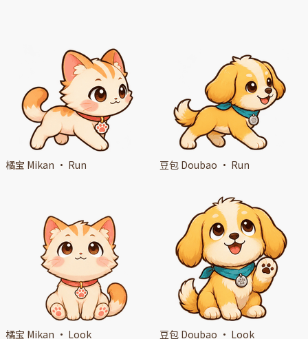

# Codex Pets · 橘宝与豆包

[中文安装教程](#中文安装教程) · [English setup](#english-setup)

**Mikan 橘宝**与 **Doubao 豆包**：原生 Codex 宠物包，以及可控制展示时长的 Windows 独立桌面伙伴。两只宠物均有 8 帧右跑、8 帧左跑及 16 个转头方向；独立版支持中文／英文即时切换。

Native Codex pets and a standalone Windows desktop companion, featuring articulated running, sixteen head directions, persistent task states and live Chinese/English switching.



| 版本 / Edition | 状态 / Status | 下载 / Download |
| --- | --- | --- |
| 原生宠物 / Native pets | 支持 v2 自定义宠物的 Codex 客户端 / Requires a compatible client | [Native ZIP](downloads/Codex-Pets-Native.zip?raw=true) |
| Windows 独立版 / Windows companion | Windows + Python 3.10+，含 Tcl/Tk / includes Tcl/Tk | [Windows ZIP](downloads/Codex-Pets-Windows.zip?raw=true) |
| macOS 独立版 / macOS companion | 预留，尚未实现 / Planned, not implemented | [macOS](standalone/macos/README.md) |
| iOS 版 / iOS companion | 预留，尚未实现 / Planned, not implemented | [iOS](standalone/ios/README.md) |

[SHA-256 校验 / Checksums](downloads/SHA256SUMS.txt) · [MIT License](LICENSE) · [隐私说明 / Privacy](PRIVACY.md)

## 中文安装教程

### 1. 原生宠物版

1. 下载 **Native ZIP**，完整解压，不要在压缩包里直接运行。
2. Windows 双击 `install.cmd`，无需 Python 或管理员权限。
3. 在支持 v2 自定义宠物的 Codex 客户端中刷新宠物列表，选择 **橘宝 Mikan** 或 **豆包 Doubao**；未更新时切换一次宠物或重启客户端。

默认安装到 `~/.codex/pets`；设置 `CODEX_HOME` 时使用其 `pets` 子目录。重复安装会把旧宠物备份到同级的 `pet-backups`，备份不会混入宠物列表。自定义位置可运行：

```powershell
powershell.exe -NoProfile -ExecutionPolicy Bypass -File .\install.ps1 -Destination "目标目录"
```

仓库源码中的对应路径为 `native/install.cmd`。包中也提供 `sh install.sh`，可在有兼容客户端的 macOS/Linux 环境使用；该脚本尚未在这些系统实测。它是原生包安装脚本，不是已完成的 macOS 独立应用。

**原生版边界：** 动画时长、任务触发、悬停和移动由 Codex 客户端控制，宠物包无法延长客户端的播放时间。原生界面语言也由 Codex 设置控制，宠物名称保留中英双语。

卸载时先关闭宠物，再删除安装目录中的 `mikan` 和 `doubao`。恢复旧版时，将 `pet-backups` 中所需备份复制回 `pets` 并改回对应名称。

### 2. Windows 独立增强版

1. 安装标准 **Python 3.10 或更新版本**，保留 **Tcl/Tk** 和 **Python Launcher** 组件。可从 [python.org](https://www.python.org/downloads/windows/) 获取；安装后确认 `py -3 -c "import tkinter"` 可运行。项目不捆绑 Python，不依赖 Codex 私有运行时，也没有第三方 Python 依赖。
2. 下载 **Windows ZIP** 并完整解压。
3. 双击 `start-doubao.cmd` 或 `start-mikan.cmd`。两只可同时运行，也可以和原生版共存。
4. 右键 **语言 / Language → 中文 / English**，可随时切换菜单、状态、气泡和标题，切换不重置任务或倒计时；偏好会自动保存。

从仓库源码启动时，进入 `standalone/windows` 执行相同文件。也可指定启动语言：

```powershell
powershell.exe -NoProfile -ExecutionPolicy Bypass -File .\launch.ps1 -Mode doubao -Language en
```

**互动与展示时长**

- 单击摸头、双击玩球、中键喂食；拖动可移动窗口，右键打开全部互动，Esc 退出。
- 摸头、喂食、握爪和摸肚皮至少展示 5 秒；玩球、跑步和散步至少 6 秒；睡觉至少 10 秒。主动选择另一项互动可以替换当前互动。
- 右键状态预览菜单可测试工作、等待、完成、审阅和失败。工作／等待持续显示到状态改变；完成、审阅、失败保持至少 10 秒，新活动任务可优先切入。
- 悬停、视线跟随和自动散步不会覆盖任务状态。自动散步默认关闭，可在菜单开启；跑步会实际移动窗口并在屏幕边缘转向。
- 空闲时宠物会逐步转头看向附近鼠标，可在菜单关闭。原有的工作、睡觉等其他姿态继续保留。

### 3. 可选：连接真实 Codex 任务

1. 保持独立版运行，双击 `enable-task-link.cmd`。
2. 安装器会合并用户级 `hooks.json` 并备份已有文件，保留其他 hooks。重新启动／恢复 Codex 后，按提示审阅并信任新增 hooks；CLI 可使用 `/hooks`。安装器不会替你信任 hooks 或改变批准决策。
3. 开始新任务：提交请求进入工作，工具批准请求进入等待，工具继续执行恢复工作，本轮停止后展示完成，中断／会话结束回到空闲。
4. 双击 `disable-task-link.cmd` 可移除**此安装目录**注册的 hooks。迁移安装目录前先在旧目录禁用，再在新目录启用。

联动使用 [Codex 官方生命周期 hooks](https://learn.chatgpt.com/docs/hooks)。只消费启动后收到的状态事件，不读取聊天记录或推测启动前已有任务。多会话时等待优先于工作，任一活动任务都优先于闲逛。普通文字提问不一定触发批准 hook，工具报错也不一定代表整个任务失败，因此这两类状态不保证自动识别，可手动预览。端到端行为需要在所用客户端中验收；单元测试不等于已经接通真实任务。

若客户端强制退出、结束事件丢失，可右键清除任务状态。退出独立版不影响原生宠物。若使用系统 Python 的路径发生变化，先禁用再重新启用任务联动。

### 4. 数据与排错

位置、语言偏好、最小状态事件和错误日志保存在 `%LOCALAPPDATA%/CodexPets`，不写入发布目录；`CODEX_PETS_DATA` 可指定其他位置。事件只保留状态、哈希化会话／任务标识和时间，不保存 prompt、工具参数、输出、账户或密钥，不读取 transcript，不发送网络请求。

若双击没有窗口，检查 Python/Tcl/Tk，或查看上述数据目录中的错误日志。首次使用、重启后或尚未信任 hooks 时，不应把空闲状态误认为任务联动已经工作。

## English setup

### 1. Native pets

1. Download **Native ZIP** and extract it completely.
2. On Windows, double-click `install.cmd`. No Python or administrator access is required.
3. Refresh custom pets in a Codex client that supports v2 sprite sheets. Select **Mikan** or **Doubao**. Reselect the pet or restart the client if artwork is cached.

The default destination is `~/.codex/pets`, or `CODEX_HOME/pets` when configured. Existing pets are backed up to the sibling `pet-backups` directory. For a custom destination, use the PowerShell command shown above. From the source repository, start in `native/`.

`sh install.sh` is included for compatible macOS/Linux clients, but has not been tested on those operating systems. This script does not constitute a released macOS standalone application. Native playback duration, task triggers, pointer reactions, movement and UI language are controlled by Codex, not by the pet package.

To uninstall, close the pet and remove its `mikan` or `doubao` directory. To restore a backup, copy it from `pet-backups` back into `pets` under the original name.

### 2. Standalone Windows companion

1. Install standard **Python 3.10+ with Tcl/Tk and Python Launcher** from [python.org](https://www.python.org/downloads/windows/). Verify `py -3 -c "import tkinter"`. No third-party Python packages or Codex-private runtime are required. Python itself is not bundled.
2. Download and fully extract **Windows ZIP**.
3. Run `start-doubao.cmd` or `start-mikan.cmd`. From source, use `standalone/windows/`.
4. Right-click → **Language / 语言 → English / 中文**. Menus, state labels, notices and the window title switch immediately, without resetting active states or timers. Language preference is saved. The PowerShell launch command above can also select a startup language.

Click for head pats, double-click to play ball, middle-click for a snack, drag to reposition, or right-click for the complete menu. Press Esc to quit. Most interactions last at least 5 seconds; running, walking and playing ball last at least 6 seconds. A new deliberate interaction may replace the current one. Task states take priority over interactions and roaming.

Use the state-preview menu to inspect working, waiting, success, review and failure. Working and waiting remain visible until changed. Results stay for at least 10 seconds unless a new active task supersedes them. Idle roaming is optional and off by default. Running moves the window and turns at screen edges. Pointer tracking uses sixteen head directions only while idle and can be disabled.

### 3. Optional task integration

Run the companion, then `enable-task-link.cmd`. This merges user-level hooks and backs up existing configuration. Restart/resume Codex and review/trust the new hooks when prompted; the CLI provides `/hooks`. Trust and approval decisions are never bypassed. The integration follows [official lifecycle hooks](https://learn.chatgpt.com/docs/hooks).

Prompt submission starts work; tool approval requests show waiting; tool activity resumes work; a stopped turn shows completion; interrupt/session end clears the state. Only events received after launch are consumed. No transcript is read or historical task guessed. Multiple sessions prioritize waiting over working. Plain-text questions and overall task failures cannot always be inferred from available hook events; manual state preview remains available. Real client integration still requires end-to-end verification.

Run `disable-task-link.cmd` from the same installation directory to remove only its registered hooks. Disable the old installation before moving it or changing Python paths, then enable the new one. If a crashed client leaves a stale state, clear tasks from the context menu.

### 4. Privacy and troubleshooting

Runtime settings, language, minimal state events and error logs stay in `%LOCALAPPDATA%/CodexPets`, or `CODEX_PETS_DATA` when set. Events contain only a state, hashed session/task identifiers and a timestamp. No prompts, tool arguments, outputs, transcripts, credentials or account identifiers are collected or uploaded. The companion makes no network requests.

If no window opens, verify Python/Tcl/Tk and inspect the local error log. The downloads contain no Git history. GitHub's own commit metadata is separate from package contents; see [PRIVACY.md](PRIVACY.md).

## Repository layout / 仓库目录

```text
native/                  Codex v2 pets and installers
standalone/windows/      Windows companion and optional hooks
standalone/macos/        Reserved; no implementation
standalone/ios/          Reserved; no implementation
downloads/               Clean edition-specific ZIPs and SHA-256 checksums
media/                   Animation preview
```

Community project; not an official OpenAI release. / 社区项目，与 OpenAI 官方发行无关。macOS and iOS standalone editions are not available yet. / macOS 与 iOS 独立版尚未提供。
