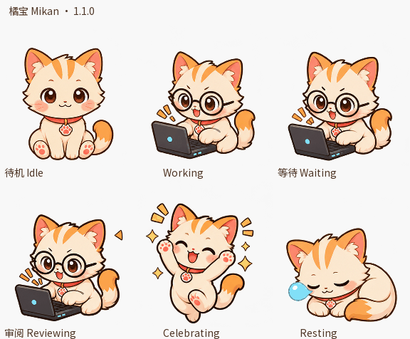
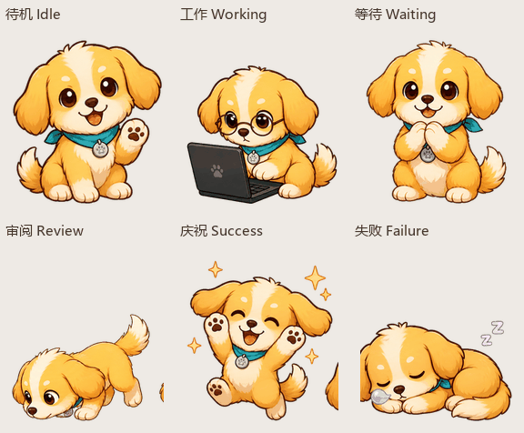
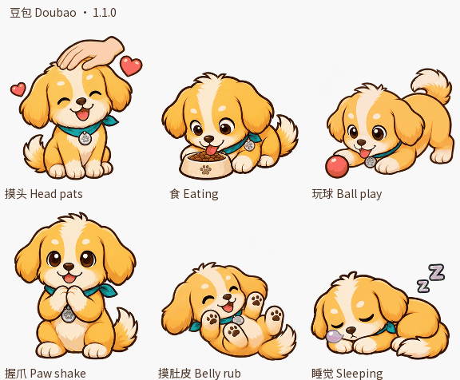

# Codex Pets · 橘宝与豆包

[中文安装教程](#中文安装教程) · [English setup](#english-setup) · [v1.0.0 Release](https://github.com/RobertsVault/Codex-Pets/releases/tag/v1.0.0)

**橘宝 Mikan** 与 **豆包 Doubao**，提供原生 Codex 宠物包和 Windows 独立桌面伙伴。原生版使用多帧姿态；独立版提供每只 12 类细致动画、真实迈腿跑步、16 个转头方向、中英切换及 1×／1.5×／2× 显示尺寸，默认 2×。宠物背景与文字栏透明。

**Mikan** and **Doubao** are available as native Codex pets and a standalone Windows companion. Native pets use multi-frame poses. The companion adds twelve detailed animation states per pet, articulated running, sixteen head directions, Chinese/English switching and 1×/1.5×/2× display sizes (2× by default), with transparent backgrounds and text areas.


| 版本 / Edition | 要求 / Requirements | 下载 / Download |
| --- | --- | --- |
| 原生宠物 / Native pets | 支持 v2 自定义宠物的 Codex 客户端 / v2-compatible Codex client | [Native ZIP](https://github.com/RobertsVault/Codex-Pets/releases/download/v1.0.0/Codex-Pets-Native.zip) |
| Windows 独立版 / Windows companion | Windows + Python 3.10+、Tcl/Tk、Pillow | [Windows ZIP](https://github.com/RobertsVault/Codex-Pets/releases/download/v1.0.0/Codex-Pets-Windows.zip) |
| macOS 独立版 / macOS companion | 预留，尚未实现 / Planned, not implemented | [macOS](standalone/macos/README.md) |
| iOS 版 / iOS companion | 预留，尚未实现 / Planned, not implemented | [iOS](standalone/ios/README.md) |

[SHA-256 校验 / Checksums](downloads/SHA256SUMS.txt) · [仓库内下载 / Repository downloads](downloads/) · [MIT License](LICENSE) · [隐私说明 / Privacy](PRIVACY.md)

### 动画 / Animations

| 宠物 / Pet | 工作与休息 / Tasks and rest | 互动 / Interactions |
| --- | --- | --- |
| 橘宝 Mikan |  |  |
| 豆包 Doubao |  |  |

上述细致动画展示独立版表现。原生版按客户端固定帧表播放，动作集合与持续时间有所不同。

Detailed animation previews show the standalone edition. Native playback follows the client's fixed frame table and has a different action set and timing.

## 中文安装教程

### 1. 原生宠物版

1. 下载 **Native ZIP**，完整解压，不要直接在压缩包中运行。
2. Windows 双击 `install.cmd`，无需 Python 或管理员权限。
3. 在支持 v2 自定义宠物的 Codex 客户端中刷新宠物列表，选择 **橘宝 Mikan** 或 **豆包 Doubao**。若素材被缓存，重新选择宠物或重启客户端。

默认安装到 `~/.codex/pets`；设置 `CODEX_HOME` 时使用其 `pets` 子目录。安装器会将已有宠物备份到同级 `pet-backups`。从仓库源码安装时，进入 `native/` 运行相同文件。自定义安装位置：

```powershell
powershell.exe -NoProfile -ExecutionPolicy Bypass -File .\install.ps1 -Destination "目标目录"
```

`sh install.sh` 可用于有兼容客户端的 macOS/Linux 环境，尚未在这些系统实测；它不是 macOS 独立应用。

原生版的播放时长、任务触发、鼠标悬停、注视、拖动和界面语言由 Codex 客户端控制，素材包不能改变这些规则。原生版保留原有姿态，并在可用帧位加入轻微过渡动作。

卸载时先关闭宠物，再删除安装目录中的 `mikan` 和 `doubao`。恢复旧版时，将 `pet-backups` 中所需备份复制回 `pets` 并改回对应名称。

### 2. Windows 独立桌面版

1. 安装标准 **Python 3.10+**，保留 **Tcl/Tk** 和 **Python Launcher** 组件。安装后确认 `py -3 -c "import tkinter"` 可运行。
2. 下载 **Windows ZIP** 并完整解压。
3. 双击 `start-doubao.cmd` 或 `start-mikan.cmd`。首次缺少 Pillow 时，启动器会联网安装；离线环境请提前安装 `requirements.txt`。项目不捆绑 Python。
4. 右键 → **语言 / Language → 中文 / English**，随时切换文字。
5. 右键 → **显示大小 → 1× / 1.5× / 2×**，默认 2×。宠物、字体和可交互区域同步缩放，选择随每只宠物保存。尺寸与语言切换不重置任务状态或动画计时。

两只宠物可同时运行，也可与原生版共存。从仓库源码启动时，进入 `standalone/windows/`。也可指定启动语言：

```powershell
powershell.exe -NoProfile -ExecutionPolicy Bypass -File .\launch.ps1 -Mode doubao -Language en
```

单击摸头、双击玩球、中键喂食；拖动可移动窗口，右键打开互动菜单，Esc 退出。摸头、喂食、握爪和摸肚皮至少展示 5 秒；玩球、跑步和散步至少 6 秒；睡觉至少 10 秒。主动选择另一项互动可以替换当前互动。跑步会移动窗口并在屏幕边缘转向。

工作和等待持续展示到状态改变；完成、审阅、失败保持至少 10 秒，新活动任务可优先切入。任务状态优先于互动和闲逛。自动散步默认关闭；空闲时可跟随附近鼠标逐步转头。右键可以关闭自动散步、视线跟随或细致动画，也可以手动选择任务状态。

### 3. 可选：连接 Codex 任务

1. 保持独立版运行，双击 `enable-task-link.cmd`。
2. 安装器合并用户级 `hooks.json` 并备份已有文件，保留其他 hooks。重新启动／恢复 Codex，按客户端提示审阅并信任新增 hooks；CLI 可使用 `/hooks`。安装器不会自动信任 hooks 或修改批准决策。
3. 提交请求进入工作；工具批准请求进入等待；工具继续执行恢复工作；本轮停止后展示完成；中断或会话结束回到空闲。
4. `disable-task-link.cmd` 只移除此安装目录注册的 hooks。迁移目录或更换 Python 路径前，在旧目录禁用后再从新目录启用。

联动只消费宠物启动后收到的状态事件，不读取聊天记录。多会话时等待优先于工作，活动任务优先于闲逛。普通文字问题不一定触发批准 hook，工具报错也不一定代表整个任务失败；这两类状态可手动选择。客户端支持及授权情况会影响实际联动。若退出异常导致状态未清除，可右键清除任务状态。

### 4. 数据与常见问题

位置、语言、尺寸偏好、状态事件与错误日志保存在 `%LOCALAPPDATA%/CodexPets`；`CODEX_PETS_DATA` 可指定其他目录。它们不会写入下载包。事件仅包含状态、哈希化会话／任务标识和时间，不保存提示词、工具参数、输出、账户或密钥，也不读取 transcript。运行时不联网；首次安装 Pillow 依赖需要联网。

若没有窗口，检查 Python/Tcl/Tk/Pillow 及上述本机目录中的错误日志。首次启动、客户端重启后或未信任 hooks 时，空闲状态不代表任务联动已经启用。

## English setup

### 1. Native pets

1. Download **Native ZIP** and extract it fully.
2. On Windows, run `install.cmd`. Python and administrator access are not required.
3. Refresh pets in a v2-compatible Codex client and choose **Mikan** or **Doubao**. Reselect the pet or restart the client if artwork is cached.

The default destination is `~/.codex/pets`, or `CODEX_HOME/pets` when configured. Existing pets are backed up to the sibling `pet-backups` directory. From source, use `native/`. The PowerShell command above supports a custom destination.

`sh install.sh` is included for compatible macOS/Linux clients but has not been tested there. This does not constitute a released macOS standalone application. Native duration, triggers, hover/gaze reactions, dragging and UI language belong to the Codex client. The package retains original poses and adds subtle transitions in available slots.

To uninstall, close the pet and remove its `mikan` or `doubao` directory. To restore a backup, copy it from `pet-backups` into `pets` under the original name.

### 2. Windows companion

1. Install **Python 3.10+ with Tcl/Tk and Python Launcher**. Verify `py -3 -c "import tkinter"`.
2. Download and fully extract **Windows ZIP**.
3. Run `start-doubao.cmd` or `start-mikan.cmd`. The launcher installs Pillow over the network if missing; for offline use, install `requirements.txt` beforehand. Python itself is not bundled.
4. Right-click → **Language / 语言 → English / 中文**.
5. Right-click → **Display size → 1× / 1.5× / 2×** (default). The pet, text and interactive area scale together. Preferences are saved per pet. Size/language changes retain active states and animation timing.

Both pets can run together and coexist with native pets. From source, use `standalone/windows/`. The launch command above can set the startup language.

Click for head pats, double-click to play ball, middle-click for a snack, drag to reposition, or right-click for all actions. Esc quits. Most interactions last at least 5 seconds; running, walking and playing ball last at least 6 seconds; sleeping lasts at least 10 seconds. A new deliberate interaction may replace the current one. Running moves the window and turns at screen edges.

Working and waiting remain visible until changed. Results stay for at least 10 seconds unless a new active task supersedes them. Tasks take priority over interactions and roaming. Idle roaming is off by default. Pointer tracking gradually turns the head only while idle. The menu can toggle roaming, pointer tracking or detailed animation, and lets you choose states manually.

### 3. Optional task integration

Run the companion, then `enable-task-link.cmd`. This merges user-level hooks while preserving other entries and backing up the previous file. Restart/resume Codex and review/trust the new hooks when prompted; the CLI provides `/hooks`. Trust and approval decisions are never bypassed.

Prompt submission starts work; tool approval requests show waiting; tool activity resumes work; a stopped turn shows completion; interrupt/session end clears the state. Only events received after launch are consumed. No transcript is read. Multiple sessions prioritize waiting over working. Plain-text questions and overall task failure cannot always be inferred from hook events; manual state selection is available. Actual integration depends on client support and authorization.

Run `disable-task-link.cmd` from the same directory to remove only its registered hooks. Disable the old location before moving the application or changing Python paths, then enable from the new location. Clear tasks from the menu if a crashed client leaves stale state.

### 4. Privacy and troubleshooting

Settings, language, size preferences, minimal events and error logs stay in `%LOCALAPPDATA%/CodexPets`, or `CODEX_PETS_DATA` when set. They are not included in download packages. Events contain only a state, hashed session/task identifiers and a timestamp. No prompts, tool arguments, outputs, transcripts, credentials or account identifiers are collected or uploaded. Runtime makes no network requests; first-time Pillow installation requires network access.

If no window opens, verify Python/Tcl/Tk/Pillow and inspect the local error log. Idle state alone does not mean hooks are connected, especially before trust is granted or after restarting the client.

## Platforms / 平台

macOS and iOS standalone editions are reserved for future work; no executable or installer is currently offered. / macOS 与 iOS 独立版尚未提供程序或安装包。

Community project; not an official OpenAI release. / 社区项目，与 OpenAI 官方发行无关。
